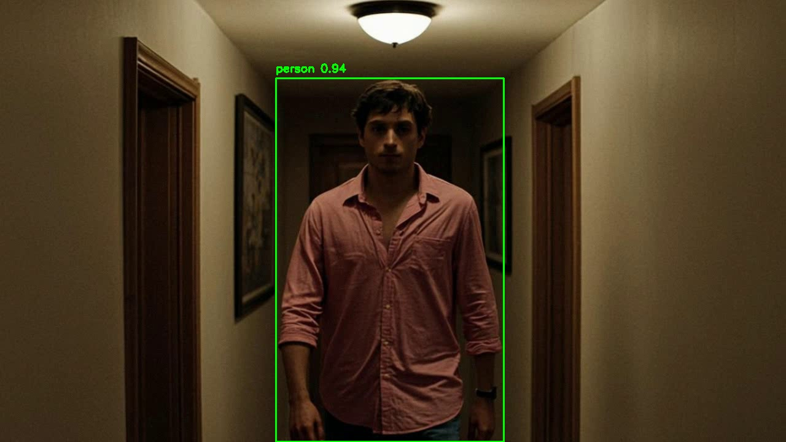
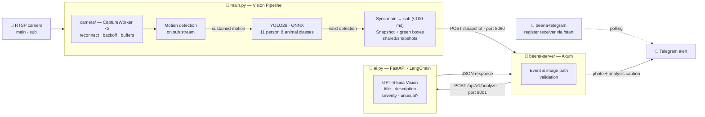

<p align="center">
  
</p>

<h1 align="center">🐝 Beena</h1>

<p align="center">
  <b>The Watchful Eye of Your Home</b> · Smart, open-source home guardian · v2.0
</p>

<p align="center">
  
  
  
  
  
  
  
  
  
</p>

**Beena** watches your camera feed — but not like a dumb recorder. Like a guard that understands. It senses motion, takes only **people and animals** seriously, captures a snapshot of the moment that matters, analyzes the scene with AI, and sends the result straight to your **Telegram** along with the photo itself.

Everything runs **on your own machine**: motion and object detection are fully local, and only the snapshot of that specific moment goes to a vision-language model to produce a short description.

**What's new in v2.0** — Beena now runs on **live RTSP network cameras**. The webcam / video-file source of v1.0 is gone; each camera is described in a validated YAML config and captured through a dedicated dual-stream worker stack (main + sub) with automatic reconnection and main/sub frame synchronization.

##  Beena at a Glance

-  **RTSP dual-stream capture** — every camera provides a `main` stream (high resolution, for snapshots) and a `sub` stream (low resolution, for analysis). Each stream runs in its own worker thread with automatic reconnection and exponential backoff (1s → 30s), so a network hiccup never kills the pipeline.
-  **Smart motion detection** — MOG2 background subtraction with Gaussian blur, CLAHE contrast enhancement and morphological cleanup; camera shake and subtle lighting changes are not mistaken for real movement.
-  **Local machine vision** — a **YOLO26** model on ONNX Runtime and CPU; of COCO's 80 classes, only the 11 that matter for home security: `person`, `bird`, `cat`, `dog`, `horse`, `sheep`, `cow`, `elephant`, `bear`, `zebra`, `giraffe`.
-  **Frame synchronization** — inference runs on the sub stream, but the saved snapshot is taken from the main frame closest in time (max delta 100 ms); detection boxes are rescaled to the main resolution automatically.
-  **AI scene analysis** — for every event it produces a **short title, a 1–3 sentence description, a severity level** (low / medium / high) and an **unusual** flag.
-  **Smart snapshots** — only when a person or animal is really in the frame; green boxes with class labels drawn on the image, and a **5-second cooldown** between events.
-  **Instant Telegram alerts** — photo + analysis through a lightweight teloxide bot; setting it up is a single `/start`.
-  **Privacy-first and ethics-aware** — no identification of people, no intent judgment, strict image-path validation, and no reads outside the shared folder.

<p align="center">
  
  <br/>
  <sub>Real output of v1.0 — a <code>person</code> detected at 0.94 confidence, with automatic analysis of the same frame</sub>
</p>

##  Architecture

Beena is built from **four independent processes** that talk to each other over HTTP and a shared disk space; each one can be kept separate, restarted, or later moved to another machine.



| Service | Run | Technology | Address | Role |
|---|---|---|---|---|
| **Vision pipeline** | `python main.py` | Python · OpenCV · ONNX Runtime | — | RTSP capture, motion, YOLO, snapshots |
| **AI service** | `python ai.py` | Python · FastAPI · LangChain | `127.0.0.1:8001` | visual analysis of each event |
| **Coordination core** | `cargo run --bin beena-server` | Rust · Axum · Tokio | `127.0.0.1:8080` | receive events, analyze, send alerts |
| **Telegram bot** | `cargo run --bin beena-telegram` | Rust · teloxide | polling | register the alert receiver via `/start` |

### The journey of an event, in six steps

1. **Frame acquisition** — the main and sub RTSP streams are captured by two independent workers into bounded frame buffers; if a stream drops, the worker reconnects on its own with growing backoff.
2. **Motion detection** — each sub frame is grayscaled, enhanced and compared against the background model; motion only counts as "real" after at least **2 consecutive frames** above the changed-pixel ratio.
3. **Machine vision** — after every **10 frames of sustained motion**, a copy of the sub frame goes **asynchronously** to YOLO26, so the camera loop never stalls for inference.
4. **Snapshot** — if a person or animal is present with enough confidence, the **synchronized main frame** (closest in time to the analyzed sub frame) is saved with boxes and labels to `shared/snapshots/`; back-to-back events are rate-limited by a **5-second cooldown**.
5. **AI analysis** — the Rust core forwards the event to the AI service; the image (with a size limit and path checks) reaches the vision model and comes back as a **guaranteed structured response** (JSON Schema).
6. **Notification** — the core sends the photo with the analysis caption to Telegram and returns `202 Accepted` to the pipeline.

##  Quick Start

### Prerequisites

- **Rust** (stable) — via [rustup](https://rustup.rs)
- **Python 3.11+**
- An RTSP camera (or a test setup: [mediamtx](https://github.com/bluenviron/mediamtx) + FFmpeg, see below)
- An OpenAI-compatible API key (or any compatible service)
- A Telegram bot: get a token from [@BotFather](https://t.me/BotFather)

### Installation

```bash
git clone https://github.com/Owurk/Beena.git
cd beena

# Python dependencies
python -m venv .venv
source .venv/bin/activate   # Windows: .venv\Scripts\activate
pip install -r requirements.txt

# Rust dependencies (beena-core is unchanged in v2.0)
cd beena-core && cargo build && cd ..
```

>  **Important:** run all commands from the **project root**; the model path (`models/yolo26n.onnx`) is resolved relative to it.

### Configuration

**1. Camera** — `config/cameras.yaml` (exactly one camera in v2.0):

```yaml
cameras:
  - id: test_camera            # used to look up credentials below
    name: Beena Test Camera    # shown in Telegram alerts
    connection:
      main_stream: rtsp://192.168.1.10:554/stream1   # high resolution
      sub_stream: rtsp://192.168.1.10:554/stream2    # low resolution
```

**2. Camera credentials** — `config/.env` (create it from `config/env.example`). Variable names are built from the camera `id`: `CAMERA_<ID>_USERNAME` / `CAMERA_<ID>_PASSWORD`. Leave both empty for a camera without authentication.

**3. AI service** — `.env` in the project root (create it from `.env.example`): `OPENAI_API_KEY`, optional `OPENAI_BASE_URL`, `AI_MODEL`.

**4. Rust core** — `beena-core/.env` (create it from `beena-core/.env.example`): `TELOXIDE_TOKEN` and `SHARED_STORAGE_ROOT` — set it to the **absolute path** of this project's `shared/` folder.

### Test setup without a real camera

[mediamtx](https://github.com/bluenviron/mediamtx) can turn any video file into the two RTSP streams Beena expects. Put `test.mp4` in the project root, start mediamtx (listens on `8554`), then run `start_streams.bat` — it publishes `rtsp://127.0.0.1:8554/main` (1920×1080) and `rtsp://127.0.0.1:8554/sub` (640×360 @ 10 fps) with FFmpeg. Verify with:

```bash
ffprobe -v error rtsp://127.0.0.1:8554/main
ffprobe -v error rtsp://127.0.0.1:8554/sub
```

### Run — four terminals

```bash
# 1) AI service  (127.0.0.1:8001)
python ai.py

# 2) Coordination core  (127.0.0.1:8080)
cargo run --bin beena-server

# 3) Telegram bot
cargo run --bin beena-telegram
#    Now open your bot in Telegram and send /start
#    so your chat_id is stored in telegram.json.

# 4) Vision pipeline
python main.py                # with preview window
python main.py --no-show      # headless
```

The preview window shows the live sub stream with `Motion: TRUE/FALSE`, the changed-pixel ratio, the threshold and the confidence. Press `q` to quit.

### `main.py` command-line parameters

| Parameter | Default | Description |
|---|---|---|
| `min_changed_ratio` | `0.002` | minimum changed-pixel ratio per frame to count as motion — 0 to 1 |
| `confidence_threshold` | `0.5` | minimum confidence to accept a YOLO detection — 0 to 1 |
| `yolo_interval` | `10` | run YOLO after every N consecutive motion frames |
| `--no-show` | — | run without the preview window |

##  Configuration files

| File | Used by | Contents |
|---|---|---|
| `config/cameras.yaml` | `main.py` | camera list (`id`, `name`, `main_stream`, `sub_stream`) — validated with Pydantic; RTSP/RTSPS URLs only |
| `config/.env` | `main.py` | `CAMERA_<ID>_USERNAME` / `CAMERA_<ID>_PASSWORD` per camera |
| `.env` (root) | `ai.py` | `OPENAI_API_KEY`, `OPENAI_BASE_URL`, `AI_PROVIDER`, `AI_MODEL`, `AI_TIMEOUT_SECONDS`, `SHARED_STORAGE_ROOT`, `MAX_IMAGE_SIZE_MB` |
| `beena-core/.env` | both Rust binaries | `TELOXIDE_TOKEN`, `SHARED_STORAGE_ROOT` |
| `telegram.json` (auto-created in `beena-core/`) | both Rust binaries | the chat ID registered via `/start` |

##  API

### `POST /snapshot` — coordination core (port 8080)

Every verified event reported by `main.py` uses this structure:

```json
{
  "event_id": "7c9e6679-7425-40de-944b-e07fc1f90ae7",
  "image_path": "snapshots/detect_20261112_155123.jpg",
  "local_time": "2026-11-12T15:51:23+03:30",
  "detected_class": "person",
  "confidence": 0.94,
  "camera_name": "Beena Test Camera"
}
```

- `image_path` is always **relative** to `SHARED_STORAGE_ROOT`; absolute paths or paths containing `..` are rejected with `400`.
- If the Telegram bot is not configured yet, the response is `503`; if the AI analysis fails, `502`.
- On success: `202 Accepted`.

### `POST /api/v1/analyze` — AI service (port 8001)

Takes the same event payload, loads the image from the shared space (allowed extensions: `jpg` / `jpeg` / `png` / `webp`, at most `MAX_IMAGE_SIZE_MB`) and returns a structured response:

```json
{
  "event_id": "7c9e6679-7425-40de-944b-e07fc1f90ae7",
  "analysis": {
    "title": "Person Standing in Hallway",
    "description": "A person wearing a pink button-up shirt stands facing the camera in a dim hallway.",
    "severity": "low",
    "is_unusual": false
  }
}
```

Errors: `404` image not found · `400` invalid image · `502` analysis failed.

### `GET /health` — AI service health check

```json
{ "status": "ok", "service": "Beena-ai" }
```

##  Project structure

```
.
├── main.py                  # main vision loop: motion → YOLO → sync → snapshot → alert
├── ai.py                    # AI analysis service (FastAPI · 127.0.0.1:8001)
├── motion_detector.py       # motion detection: MOG2 + CLAHE + morphology
├── yolo_detector.py         # YOLO26 on ONNX Runtime (CPU) + class filtering
├── camera/
│   ├── camera_manager.py    # owns the main & sub workers for one camera
│   ├── capture_worker.py    # RTSP capture thread: reconnect, backoff, buffers
│   ├── frame_buffer.py      # bounded, thread-safe frame buffer
│   ├── frame_synchronizer.py# picks the main frame closest to a sub frame
│   ├── frame.py             # Frame dataclass (image, timestamp, id, stream)
│   └── worker_state.py      # worker lifecycle states
├── config/
│   ├── cameras.yaml         # camera definitions (exactly one camera in v2.0)
│   ├── schema.py            # Pydantic validation for cameras.yaml
│   ├── loader.py            # YAML loader
│   ├── credentials.py       # per-camera credentials from environment
│   └── url_builder.py       # injects credentials into the RTSP URL (percent-encoded)
├── start_streams.bat        # test publisher: test.mp4 → mediamtx main/sub streams
├── requirements.txt
├── .env.example             # template for the AI service (project root)
├── config/env.example       # template for camera credentials
├── models/
│   ├── yolo26n.onnx         # object detection model (640×640, CPUExecutionProvider)
│   └── coco.names           # the 80 COCO class names; 11 person/animal classes are used
└── beena-core/
    ├── Cargo.toml
    └── src/bin/
        ├── server.rs        # beena-server — coordination core (Axum · 127.0.0.1:8080)
        └── telegram.rs      # beena-telegram — alert receiver registration (teloxide)
```

##  Privacy & design principles

These principles are not just slogans; they are written directly into the system prompt and the code:

- **Describe behavior, never judge intent** — the analysis never calls anyone a thief or an intruder; a person's mere presence is not suspicious.
- **No identification of people** — age, gender, ethnicity or other personal traits are never guessed; clothing and visible actions are fine.
- **Cautious by default** — when unsure, it picks the lower severity and sets `is_unusual: false`.
- **Trust the image, not the label** — the green boxes are just detector output; if the image disagrees with the detector's claim, the scene is described as it really is.
- **Immune to in-image instructions** — text visible inside the scene is never followed as an instruction.
- **Minimal data** — motion and object detection are fully local; only the snapshot of that event is used to analyze that event.
- **Path validation** — neither the Rust core nor the AI service will read an image from outside the shared folder.
- **Single receiver** — only the first user who sends `/start` receives notifications.

##  Roadmap

- [x] **RTSP network camera support** (done in v2.0)
- [ ] Multiple simultaneous cameras
- [ ] Receiver management through the bot itself (multi-user)
- [ ] Event storage and search
- [ ] GPU inference (CUDA Execution Provider)
- [ ] One-command deployment with Docker

##  Troubleshooting

| Problem | Likely cause and fix |
|---|---|
| `Camera configuration failed: ...` | `config/cameras.yaml` is missing, has more than one camera, or the stream URLs are not valid RTSP/RTSPS addresses. |
| `Could not open stream for camera ...` | Wrong IP/port/credentials, or the camera is offline. Check the URL in `config/cameras.yaml` and the credentials in `config/.env`. The worker keeps retrying with backoff. |
| Camera connects but no frames | Some cameras require TCP transport and their credentials in the URL; make sure both `main_stream` and `sub_stream` are reachable (test with `ffprobe`). |
| `Failed to load ONNX model` | You are not running from the project root; the `models/` path is relative. |
| Snapshot boxes are offset | Main and sub streams should show the same field of view (same camera); boxes are rescaled by resolution ratio only. |
| `OPENAI_API_KEY is not configured.` | Create the `.env` file in the project root with a valid key. |
| Telegram message never arrives | You have not sent `/start` to the bot (`telegram.json` missing in `beena-core/`) or `TELOXIDE_TOKEN` is wrong. Also check that `SHARED_STORAGE_ROOT` in `beena-core/.env` points to this project's `shared/` folder. |
| `503` response when sending an event | The Telegram bot is not configured yet — send `/start` and try again. |
| Event sent but `502` | `ai.py` is not running, the API key is wrong, or the snapshot path cannot be resolved inside the shared folder. |

---

<p align="center">
  Built with ☕ and love ·
  <a href="https://github.com/Owurk/Beena">GitHub</a>
</p>
