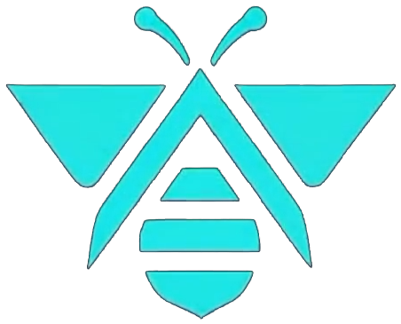
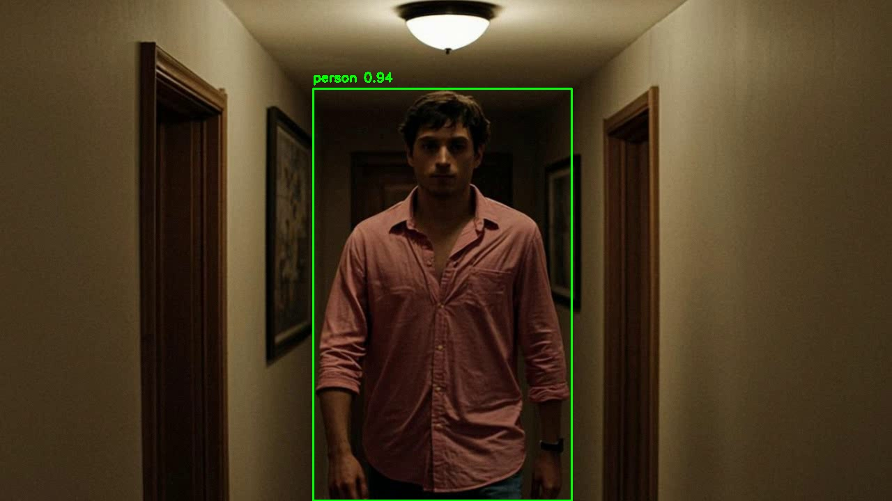
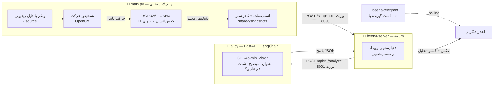

<p align="center">
  
</p>

<h1 align="center">🐝 Beena</h1>

<p align="center">
  <b>چشمِ بیدارِ خانه‌ی شما</b> · دیده‌بان هوشمند و متن‌باز · نسخه‌ی ۱.۰
</p>

<p align="center">
  
  
  
  
  
  
  
  
</p>

<div dir="rtl">

---

**Beena** به تصویر دوربین شما نگاه می‌کند؛ اما مثل یک ضبط‌کننده‌ی ساده نه — مثل یک نگهبانِ فهمیده. حرکت را حس می‌کند، فقط **انسان و حیوان** را جدی می‌گیرد، از لحظه‌ی مهم یک عکس می‌گیرد، صحنه را با هوش مصنوعی تحلیل می‌کند و نتیجه را همراه با همان عکس، مستقیم در **تلگرام** شما می‌فرستد.

همه‌چیز **روی دستگاه خودتان** اجرا می‌شود: تشخیص حرکت و تشخیص شیء کاملاً محلی است و تنها عکسِ همان لحظه‌ی خاص، برای تولید یک توضیح کوتاه به مدل بینایی زبانی می‌رود.

## ✨ Beena در یک نگاه

- 🎯 **تشخیص حرکت هوشمند** — تفاضل فریم‌ها با محوشازی گاوسی و مورفولوژی ریاضی؛ لرزش دوربین و تغییر جزئی نور را با حرکت واقعی اشتباه نمی‌گیرد.
- 🧠 **بینایی ماشین محلی** — مدل **YOLO26** روی ONNX Runtime و CPU؛ از ۸۰ کلاس COCO فقط ۱۱ کلاسِ مهم برای امنیت خانه اهمیت دارد: `person`، `bird`، `cat`، `dog`، `horse`، `sheep`، `cow`، `elephant`، `bear`، `zebra`، `giraffe`.
- 🤖 **تحلیل هوش مصنوعی صحنه** — برای هر رویداد یک **عنوان کوتاه، توضیح ۱ تا ۳ جمله‌ای، سطح شدت** (low / medium / high) و برچسب **غیرعادی بودن** تولید می‌شود.
- 📸 **اسنپ‌شات هوشمند** — فقط وقتی انسان یا حیوانی واقعاً در قاب است؛ با کادر سبز و برچسب کلاس روی تصویر، و **فاصله‌ی هوشمند ۵ ثانیه‌ای** بین رویدادها.
- 📨 **اعلان فوری تلگرام** — عکس + تحلیل، با یک ربات سبک مبتنی بر teloxide؛ تنظیمش فقط یک `/start` است.
- 🔒 **محافظت‌شده و اخلاق‌مدار** — بدون شناسایی افراد، بدون قضاوت نیت، با اعتبارسنجی سخت‌گیرانه‌ی مسیر تصویر و جلوگیری از دسترسی خارج از پوشه.

<p align="center">
  
  <br/>
  <sub>خروجی واقعی نسخه‌ی ۱.۰ — تشخیص <code>person</code> با اطمینان ۰٫۹۴ روی ویدیوی آزمایشی و تحلیل خودکار همان قاب</sub>
</p>

## 🏗 معماری

Beena از **چهار فرآیند مستقل** ساخته شده که از طریق HTTP و فضای دیسک مشترک با هم حرف می‌زنند؛ هر کدام را می‌توان جدا نگه داشت، ری‌استارت کرد یا بعداً جای دیگری اجرا کرد.

<div dir="ltr">



</div>

| سرویس | اجرا | تکنولوژی | آدرس | نقش |
|---|---|---|---|---|
| **پایپ‌لاین بینایی** | `python main.py` | Python · OpenCV · ONNX Runtime | — | دوربین، حرکت، YOLO، اسنپ‌شات |
| **سرویس هوش مصنوعی** | `python ai.py` | Python · FastAPI · LangChain | `127.0.0.1:8001` | تحلیل بصری رویداد با مدل بینایی |
| **هسته‌ی هماهنگی** | `cargo run --bin beena-server` | Rust · Axum · Tokio | `127.0.0.1:8080` | دریافت رویداد، تحلیل، ارسال اعلان |
| **ربات تلگرام** | `cargo run --bin beena-telegram` | Rust · teloxide | polling | ثبت گیرنده‌ی اعلان با `/start` |

### سفر یک رویداد، در شش گام

1. **دریافت تصویر** — قاب‌ها از وبکم زنده (بدون آرگومان) یا فایل ویدیویی با `--source` خوانده می‌شوند؛ فایل ویدیویی با FPS واقعی خودش پخش می‌شود.
2. **تشخیص حرکت** — هر قاب خاکستری، بلور گاوسی و با فریم قبلی مقایسه می‌شود؛ مورفولوژی نویز را پاک می‌کند و حرکت فقط وقتی «واقعی» است که دست‌کم **۲ فریم پشت‌سرهم** تکرار شود.
3. **بینایی ماشین** — بعد از هر **۱۰ فریم حرکت پایدار**، یک کپی از قاب به‌صورت **ناهم‌زمان** به YOLO26 می‌رود تا حلقه‌ی دوربین هرگز برای استنتاج توقف نکند.
4. **اسنپ‌شات** — اگر انسان یا حیوانی با اطمینان کافی در قاب باشد، قابِ برچسب‌خورده در `shared/snapshots/` ذخیره می‌شود؛ رویدادهای پشت‌سرهم با **فاصله‌ی ۵ ثانیه‌ای** کنترل می‌شوند.
5. **تحلیل هوش مصنوعی** — هسته‌ی Rust رویداد را به سرویس AI می‌فرستد؛ تصویر (با سقف حجمی و بررسی مسیر) به مدل بینایی می‌رسد و پاسخ با **خروجی ساخت‌یافته‌ی تضمین‌شده** (JSON Schema) برمی‌گردد.
6. **اعلان** — هسته، عکس را همراه کپشن تحلیل به تلگرام می‌فرستد و `202 Accepted` به پایپ‌لاین برمی‌گرداند.

## 🚀 شروع سریع

### پیش‌نیازها

- **Rust** (stable) — از طریق [rustup](https://rustup.rs)
- **Python 3.11+**
- یک کلید API سازگار با OpenAI (یا هر سرویس سازگار با آن)
- یک ربات تلگرام: از [@BotFather](https://t.me/BotFather) توکن بگیرید

### نصب

<div dir="ltr">

```bash
git clone <REPO_URL>        # لینک مخزن خودتان
cd beena

# وابستگی‌های پایتون
python -m venv .venv
source .venv/bin/activate   # ویندوز: .venv\Scripts\activate
pip install -r requirements.txt
pip install fastapi "uvicorn[standard]" pydantic python-dotenv langchain-openai langchain-core

# تنظیمات
cp .env.example .env        # مقادیر را مطابق جدول پایین پر کنید
```

</div>

> 💡 **مهم:** دستورات را از **ریشه‌ی پروژه** اجرا کنید؛ مسیر مدل (`models/yolo26n.onnx`) نسبت به همان‌جا خوانده می‌شود.

### اجرا — چهار ترمینال

<div dir="ltr">

```bash
# ۱) سرویس هوش مصنوعی  (127.0.0.1:8001)
python ai.py

# ۲) هسته‌ی هماهنگی  (127.0.0.1:8080)
cargo run --bin beena-server

# ۳) ربات تلگرام
cargo run --bin beena-telegram
#    حالا در تلگرام به ربات خودتان بروید و /start بزنید
#    تا chat_id شما در telegram.json ثبت شود.

# ۴) پایپ‌لاین بینایی
python main.py                          # وبکم زنده
python main.py --source walking.mp4     # فایل ویدیویی
python main.py --source walking.mp4 --no-show   # بدون پنجره (headless)
```

</div>

پنجره‌ی نمایش، وضعیت زنده را نشان می‌دهد: `Motion: TRUE/FALSE`، نسبت پیکسل‌های تغییرکرده، آستانه‌ها و شماره‌ی دوربین. برای خروج کلید `q` را بزنید. پخش فایل ویدیویی تا پایان ویدیو ادامه دارد و بعد به‌صورت تمیز تمام می‌شود.

### پارامترهای خط فرمان `main.py`

| پارامتر | پیش‌فرض | توضیح |
|---|---|---|
| `pixelThreshold` | `25` | آستانه‌ی اختلاف هر پیکسل — از ۱ تا ۲۵۵ |
| `minChangedRatio` | `0.002` | حداقل نسبت پیکسل‌های تغییرکرده در قاب — از ۰ تا ۱ |
| `confidenceThreshold` | `0.5` | حداقل اطمینان برای پذیرش تشخیص YOLO |
| `yoloInterval` | `10` | هر چند فریمِ دارای حرکت، یک‌بار YOLO اجرا شود |
| `cameraIndex` | `0` | ایندکس وبکم — از ۰ تا ۱۰ |
| `--source FILE` | — | پخش فایل ویدیویی به‌جای وبکم، مثلا `walking.mp4` |
| `--no-show` | — | اجرای بدون پنجره‌ی گرافیکی |

## ⚙️ تنظیمات (`.env`)

<div dir="ltr">

```env
OPENAI_API_KEY=sk-...
OPENAI_BASE_URL=...            # اختیاری — برای سرویس‌های سازگار با OpenAI
AI_PROVIDER=openai
AI_MODEL=gpt-4o-mini
AI_TIMEOUT_SECONDS=30
SHARED_STORAGE_ROOT=./shared
MAX_IMAGE_SIZE_MB=10
TELOXIDE_TOKEN=123456:ABC-...  # توکن ربات از BotFather — برای هر دو باینری Rust الزامی است
```

</div>

| متغیر | پیش‌فرض | مصرف‌کننده | توضیح |
|---|---|---|---|
| `OPENAI_API_KEY` | — | `ai.py` | کلید API مدل بینایی — الزامی |
| `OPENAI_BASE_URL` | — | `ai.py` | آدرس سرویس سازگار با OpenAI — اختیاری |
| `AI_PROVIDER` | `openai` | `ai.py` | فعلاً فقط `openai` پشتیبانی می‌شود |
| `AI_MODEL` | `gpt-4o-mini` | `ai.py` | مدل تحلیل تصویر |
| `AI_TIMEOUT_SECONDS` | `30` | `ai.py` | مهلت پاسخ هر درخواست تحلیل |
| `SHARED_STORAGE_ROOT` | `./shared` | `ai.py` و هر دو باینری Rust | ریشه‌ی فضای مشترک اسنپ‌شات‌ها |
| `MAX_IMAGE_SIZE_MB` | `10` | `ai.py` | سقف حجم تصویر ورودی تحلیل |
| `TELOXIDE_TOKEN` | — | `beena-server` و `beena-telegram` | توکن ربات تلگرام — الزامی |

علاوه بر این‌ها، فایل **`telegram.json`** به‌صورت خودکار ساخته می‌شود: با اولین `/start`، شناسه‌ی چت شما در آن ذخیره می‌شود و Beena فقط برای **همان یک گیرنده** اعلان می‌فرستد.

## 🔌 API

### `POST /snapshot` — هسته‌ی هماهنگی (پورت ۸۰۸۰)

هر رویدادِ تأییدشده توسط `main.py` با این ساختار اطلاع داده می‌شود:

<div dir="ltr">

```json
{
  "event_id": "7c9e6679-7425-40de-944b-e07fc1f90ae7",
  "image_path": "snapshots/detect_20261112_155123.jpg",
  "local_time": "2026-11-12T15:51:23+03:30",
  "detected_class": "person",
  "confidence": 0.94,
  "camera_name": "walking.mp4"
}
```

</div>

- `image_path` همیشه **نسبی** نسبت به `SHARED_STORAGE_ROOT` است؛ مسیر مطلق یا شامل `..` با خطای `400` رد می‌شود.
- اگر ربات تلگرام هنوز تنظیم نشده باشد پاسخ `503` و اگر تحلیل AI شکست بخورد `502` برمی‌گردد.
- در موفقیت: `202 Accepted`.

### `POST /api/v1/analyze` — سرویس هوش مصنوعی (پورت ۸۰۰۱)

همان payload رویداد را می‌گیرد، تصویر را از فضای مشترک می‌خواند (پسوندهای مجاز: `jpg` / `jpeg` / `png` / `webp`، حداکثر `MAX_IMAGE_SIZE_MB`) و پاسخ ساخت‌یافته برمی‌گرداند:

<div dir="ltr">

```json
{
  "event_id": "7c9e6679-7425-40de-944b-e07fc1f90ae7",
  "analysis": {
    "title": "Person Standing in Hallway",
    "description": "A person wearing a pink button-up shirt stands facing the camera in a dim hallway.",
    "severity": "low",
    "is_unusual": false
  }
}
```

</div>

خطاها: `404` تصویر پیدا نشد · `400` تصویر نامعتبر · `502` شکست تحلیل.

### `GET /health` — بررسی سلامت سرویس AI

<div dir="ltr">

```json
{ "status": "ok", "service": "Beena-ai" }
```

</div>

## 📁 ساختار پروژه

<div dir="ltr">

```
.
├── main.py                  # حلقه‌ی اصلی بینایی: حرکت ← YOLO ← اسنپ‌شات ← اعلان
├── ai.py                    # سرویس تحلیل هوش مصنوعی (FastAPI · 127.0.0.1:8001)
├── capture.py               # لایه‌ی دسترسی به منبع تصویر (وبکم / فایل ویدیویی)
├── motion_detector.py       # تشخیص حرکت: گاوسی + تفاضل فریم + مورفولوژی
├── yolo_detector.py         # YOLO26 روی ONNX Runtime (CPU) + فیلتر کلاس‌ها
├── requirements.txt
├── .env.example
├── models/
│   ├── yolo26n.onnx         # مدل تشخیص شیء (640×640، CPUExecutionProvider)
│   └── coco.names           # نام ۸۰ کلاس COCO؛ ۱۱ کلاس انسان/حیوان استفاده می‌شود
└── beena-core/
    ├── Cargo.toml
    └── src/bin/
        ├── server.rs        # beena-server — هسته‌ی هماهنگی (Axum · 127.0.0.1:8080)
        └── telegram.rs      # beena-telegram — ثبت گیرنده‌ی اعلان (teloxide)
```

</div>

## 🔒 حریم خصوصی و اصول طراحی

این اصول فقط شعار نیستند؛ مستقیم در پرامپت سیستم و کد نوشته شده‌اند:

- **توصیف رفتار، نه قضاوت نیت** — تحلیل هرگز کسی را «سارق» یا «مهاجم» نام نمی‌کند؛ حضور یک نفر به‌خودی‌خود مشکوک نیست.
- **بدون شناسایی افراد** — سن، جنسیت، قومیت یا هر ویژگی شخصی حدس زده نمی‌شود؛ لباس و رفتار قابل‌توصیف است.
- **محتاط به‌صورت پیش‌فرض** — در شرایط نامطمئن، سطح شدت پایین‌تر و `is_unusual: false` انتخاب می‌شود.
- **اعتماد به تصویر، نه به برچسب** — کادرهای سبز فقط خروجی تشخیص‌دهنده‌اند؛ اگر تصویر خلاف ادعای مدل باشد، همان توصیف می‌شود.
- **مقاوم در برابر دستور داخل تصویر** — متنی که داخل صحنه دیده می‌شود، هرگز به‌عنوان دستور اجرا نمی‌شود.
- **حداقل داده** — تشخیص حرکت و شیء کاملاً محلی است و فقط عکسِ همان رویداد، برای تحلیل همان رویداد استفاده می‌شود.
- **اعتبارسنجی مسیر** — هم هسته‌ی Rust و هم سرویس AI اجازه‌ی خواندن تصویر از خارج از فضای مشترک را نمی‌دهند.
- **تک‌گیرنده** — فقط اولین کاربری که `/start` می‌زند اعلان‌ها را دریافت می‌کند.

## 🗺 نقشه‌ی راه

- [ ] اتصال به دوربین‌های شبکه با **RTSP** (در نسخه‌ی ۱.۰ هنوز موجود نیست — فعلاً وبکم و فایل ویدیویی)
- [ ] پشتیبانی از چند دوربین به‌صورت هم‌زمان
- [ ] مدیریت گیرنده‌ها از طریق خود ربات تلگرام (چند کاربر)
- [ ] ذخیره‌سازی و جست‌وجوی رویدادها
- [ ] کانتینری‌سازی با Docker برای استقرار تک‌فرمانی

## 🛠 عیب‌یابی سریع

| مشکل | علت محتمل و راه‌حل |
|---|---|
| `Could not open video source!` | وبکم توسط برنامه‌ی دیگری اشغال است یا ایندکس اشتباه است؛ ایندکس را به‌عنوان پنجمین آرگومان تغییر دهید (مثلاً `python main.py 25 0.002 0.5 10 1`). |
| `Failed to load ONNX model` | از ریشه‌ی پروژه اجرا نکرده‌اید؛ مسیر `models/` نسبی است. |
| `OPENAI_API_KEY is not configured.` | فایل `.env` کنار `ai.py` را با کلید معتبر بسازید. |
| پیام تلگرام نمی‌رسد | به ربات `/start` نداده‌اید (`telegram.json` وجود ندارد) یا توکن `TELOXIDE_TOKEN` اشتباه است. |
| پاسخ `503` در ارسال رویداد | ربات تلگرام هنوز پیکربندی نشده — `/start` را بزنید و دوباره تلاش کنید. |
| ویدیو سریع‌تر از واقعیت پخش می‌شود | طبیعی نیست؛ `main.py` سرعت پخش را با FPS فایل هماهنگ می‌کند — اگر FPS فایل صفر بود، به‌صورت خودکار ۳۰ در نظر گرفته می‌شود. |

---

<p align="center">
  ساخته‌شده با ☕ و علاقه ·
  <a href="https://github.com/jackyJa">GitHub</a>
</p>

</div>
