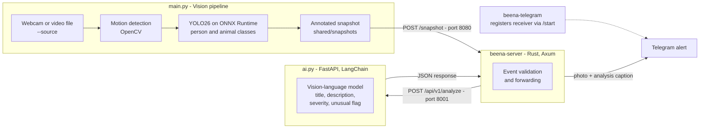

<p align="center">
  
</p>

<h1 align="center">🐝 Beena</h1>

<p align="center">
  <b>The Watchful Eye of Your Home</b> · Smart, open-source home guardian · v1.0
</p>

<p align="center">
  
  
  
  
  
  
</p>

Beena watches a camera feed the way a guard would, not the way a recorder does. It detects motion, confirms that a person or an animal is actually in the frame using a local neural network, saves an annotated snapshot of the moment that matters, and sends it to Telegram together with a short AI-generated description of the scene.

Motion detection and object detection run entirely on your own machine. Only the snapshot of a detected event is sent to a vision-language model to produce the scene description, and only to the endpoint you configure.

---

## Features (v1.0)

- **Motion detection that ignores noise.** MOG2 adaptive background subtraction with Gaussian blur, CLAHE contrast enhancement, shadow removal and morphological cleanup. Motion is accepted only after at least two consecutive frames above the changed-pixel threshold, so camera shake and gradual lighting changes do not trigger events.
- **Local object detection.** YOLO26 nano on ONNX Runtime (CPU) at 640x640. Of COCO's 80 classes, only the eleven that matter for home security are kept: `person`, `bird`, `cat`, `dog`, `horse`, `sheep`, `cow`, `elephant`, `bear`, `zebra`, `giraffe`.
- **Asynchronous pipeline.** Inference and notification HTTP calls run in dedicated worker threads, so slow model execution never stalls the camera loop.
- **AI scene analysis.** Every event is analyzed by a vision-language model that returns a schema-enforced result: a short title, a one-to-three sentence factual description, a severity level (`low` / `medium` / `high`) and an `is_unusual` flag.
- **Smart snapshots.** Only frames with a confirmed person or animal are saved, annotated with green boxes and confidence labels, under `shared/snapshots/`. Back-to-back events are rate-limited by a five-second cooldown.
- **Instant Telegram alerts.** The photo and its analysis reach your Telegram within seconds through a lightweight bot. Setup is a single `/start` message.
- **Privacy-first and ethics-aware.** No identification of people, no judgment of intent, strict image-path validation, and no file access outside the shared storage folder.

<p align="center">
  
  <br/>
  <sub>Real output of v1.0 - a person detected at 0.94 confidence, with automatic analysis of the same frame.</sub>
</p>

---

## Architecture

Beena is built from four independent processes that talk to each other over localhost HTTP and one shared disk folder. Each process can be started, restarted, or later moved to another machine on its own.



| Service | Run | Technology | Address | Role |
|---|---|---|---|---|
| Vision pipeline | `python main.py` | Python, OpenCV, ONNX Runtime | - | camera input, motion, YOLO, snapshots |
| AI service | `python ai.py` | Python, FastAPI, LangChain | `127.0.0.1:8001` | visual analysis of each event |
| Coordination core | `cargo run --bin beena-server` | Rust, Axum, Tokio | `127.0.0.1:8080` | receive events, request analysis, send alerts |
| Telegram bot | `cargo run --bin beena-telegram` | Rust, teloxide | polling | register the alert receiver via `/start` |

### The journey of an event

1. **Frame acquisition.** Frames come from the live webcam (no arguments) or a video file via `--source`. Video files are paced at their real FPS and exit cleanly when playback ends.
2. **Motion detection.** Each frame is grayscaled, blurred, contrast-enhanced and passed through an adaptive background subtractor; morphology removes noise and shadows. Motion counts as real only after at least 2 consecutive frames above the threshold.
3. **Machine vision.** After every N motion frames (`yoloInterval`, default 10), a copy of the frame goes asynchronously to YOLO26. The camera loop never waits for inference.
4. **Snapshot.** If a person or animal is present with enough confidence, the annotated frame is saved to `shared/snapshots/`. A five-second cooldown separates consecutive events.
5. **AI analysis.** The Rust core validates the event (the image path must resolve inside the shared folder) and forwards it to the AI service, which loads the image, applies size and type checks, and returns a structured analysis.
6. **Notification.** The core sends the photo with the analysis caption to the registered Telegram chat and returns `202 Accepted` to the pipeline.

---

## Repository layout

```text
.
├── main.py                    # Vision pipeline: capture, motion, YOLO, snapshots, event dispatch
├── capture.py                 # Video source wrapper (webcam index, file, RTSP URL)
├── motion_detector.py         # MOG2 background subtraction with CLAHE and morphology
├── yolo_detector.py           # YOLO26 ONNX inference and class filtering
├── ai.py                      # FastAPI analysis service (vision-language model)
├── requirements.txt           # Python dependencies (vision pipeline)
├── .env.example               # Configuration template for the AI service
├── models/
│   ├── yolo26n.onnx           # YOLO26 nano model, ONNX format
│   └── coco.names             # COCO class names
├── assets/                    # Logo and demo output image
└── beena-core/
    ├── Cargo.toml             # Rust workspace (beena-server, beena-telegram)
    ├── .env.example           # Configuration template for the Rust services
    └── src/bin/
        ├── server.rs          # Axum event core on 127.0.0.1:8080
        └── telegram.rs        # teloxide bot that registers the alert receiver
```

---

## Requirements

- Python 3.11 or newer
- Rust (stable toolchain) to build the two Rust services, via [rustup](https://rustup.rs)
- OpenCV 4.10 and ONNX Runtime (installed with the Python requirements)
- An OpenAI-compatible API key for the vision-language model used by `ai.py`
- A Telegram bot token, obtained from [@BotFather](https://t.me/BotFather)

A webcam (built-in or USB) for live input, or any video file for testing. Network camera support is on the roadmap (see below).

---

## Configuration

Two `.env` files configure the services. Run each service from the directory that contains its `.env` file, and point both at the **same shared folder** so the pipeline, the core and the AI service agree on where snapshots live. An absolute path is recommended.

**Project root - `.env`** (used by `ai.py`):

| Variable | Default | Description |
|---|---|---|
| `OPENAI_API_KEY` | - | API key for the vision-language model (required) |
| `OPENAI_BASE_URL` | - | Override the API base URL for compatible providers (optional) |
| `AI_PROVIDER` | `openai` | Analysis provider; only `openai`-compatible providers are supported |
| `AI_MODEL` | `gpt-6-luna` | Model name used for scene analysis |
| `AI_TIMEOUT_SECONDS` | `30` | Timeout for a single analysis request |
| `SHARED_STORAGE_ROOT` | `./shared` | Shared folder; image paths are validated inside it |
| `MAX_IMAGE_SIZE_MB` | `10` | Maximum accepted snapshot size |

**`beena-core/.env`** (used by both Rust binaries):

| Variable | Default | Description |
|---|---|---|
| `TELOXIDE_TOKEN` | - | Telegram bot token (required) |
| `SHARED_STORAGE_ROOT` | `./shared` | Must point to the same folder as above |

---

## Installation and startup

```bash
git clone https://github.com/Owurk/Beena.git
cd Beena

# Python dependencies
python -m venv .venv
source .venv/bin/activate            # Windows: .venv\Scripts\activate
pip install -r requirements.txt
pip install fastapi "uvicorn[standard]" pydantic python-dotenv langchain-openai langchain-core

# Configuration
cp .env.example .env                 # fill in the values, see the tables above
cp beena-core/.env.example beena-core/.env
```

Run the four processes in this order (four terminals):

```bash
# 1) AI service (127.0.0.1:8001) - from the project root
python ai.py

# 2) Coordination core (127.0.0.1:8080) - from beena-core/
cd beena-core
cargo run --bin beena-server

# 3) Telegram bot - from beena-core/
cargo run --bin beena-telegram
#    Open your bot in Telegram and send /start so your chat_id
#    is stored in telegram.json. This registers the alert receiver.

# 4) Vision pipeline - from the project root
python main.py                          # live webcam
python main.py --source walking.mp4     # video file
python main.py --source walking.mp4 --no-show   # headless
```

`main.py` resolves the model files relative to the project root, so start it from there. The Rust binaries read `telegram.json` from their working directory, so start both of them from `beena-core/`.

With a live source the preview window shows the current motion status, the changed-pixel ratio, the thresholds and the camera index. Press `q` to quit. A video file plays to the end and then exits cleanly.

### `main.py` command-line parameters

| Parameter | Default | Description |
|---|---|---|
| `pixelThreshold` | `25` | per-pixel difference threshold, 1 to 255 |
| `minChangedRatio` | `0.002` | minimum changed-pixel ratio per frame, 0 to 1 |
| `confidenceThreshold` | `0.5` | minimum confidence to accept a YOLO detection |
| `yoloInterval` | `10` | run YOLO once every N frames with sustained motion |
| `cameraIndex` | `0` | webcam index, 0 to 10, used when `--source` is not given |
| `--source` | - | path to a video file, or an RTSP URL (experimental, see roadmap) |
| `--no-show` | - | run headless, no preview window |

---

## Service endpoints

| Endpoint | Method | Purpose |
|---|---|---|
| `POST 127.0.0.1:8080/snapshot` | POST | Event intake for the vision pipeline; validates the image path and returns `202 Accepted` |
| `POST 127.0.0.1:8001/api/v1/analyze` | POST | Scene analysis of one event; returns a schema-validated JSON response |
| `GET 127.0.0.1:8001/health` | GET | Health check for the AI service |

The event payload contains `event_id`, `image_path` (relative to the shared folder), `local_time`, `detected_class`, `confidence` and `camera_name`.

All endpoints bind to `127.0.0.1` only. Nothing is exposed to the network in v1.0.

---

## Privacy and data handling

- Motion detection and object detection run **fully locally**. No video ever leaves the machine.
- Only the snapshot of a detected event is sent to the vision-language model endpoint you configure, together with the event metadata.
- The system never identifies people, never judges intent, and prefers the lower severity when the scene is ambiguous.
- Image paths are validated twice (in the Rust core and in the AI service): relative paths only, no traversal, resolved inside the shared storage root, restricted to `jpg`, `jpeg`, `png`, `webp`, with a size cap.
- Instructions found inside scene images are ignored by the analysis model; scene content cannot steer the system.

---

## Roadmap

Version 1.0 is a deliberately small, well-tested foundation: a single local camera (USB webcam or video file), one analysis pipeline, one Telegram receiver. The goal for the next versions is different in kind: **let users run Beena against their own camera systems** - the IP cameras they already own.

This matters because of how the camera industry actually works. Consumer cameras run closed, signed embedded firmware on very small chips; third-party software cannot be installed on them. Every mainstream surveillance application therefore follows the same model: the software runs on a separate host (a mini PC, a NAS, a Raspberry Pi) and **pulls video from the cameras over the network** using RTSP, with ONVIF as the discovery and configuration standard. Beena already fits this model architecturally - the work ahead is an ingestion and packaging project, not a rewrite.

The roadmap below is ordered by priority; each phase is independently useful and ends in a demonstrable release.

### Phase 1 - Hardened RTSP ingestion (planned)

Bring network cameras in as first-class video sources.

- Force TCP transport for RTSP (UDP streams stall or corrupt behind routers), with bounded buffering so Beena always analyzes the newest frame.
- Replace the current five-retries-then-exit behavior with continuous reconnection using exponential backoff.
- Add a stale-frame watchdog that detects a frozen stream.
- Parse and encode credentials safely, and produce actionable errors (wrong password, unreachable host, bad URL).
- Analyze the camera's low-resolution **sub stream** for motion and detection, and grab the snapshot from the high-resolution **main stream** so alerts stay sharp. This keeps CPU cost per camera low.
- Pace network sources by their real frame rate.

*Acceptance: a 24-hour soak test against a real camera, including camera reboots and network interruptions, recovers automatically and drops no events.*

### Phase 2 - Camera abstraction and multi-camera support (planned)

Run N cameras with one Beena installation.

- A `CameraSource` interface with three implementations: USB webcam, video file, RTSP source - so today's paths become special cases of one abstraction.
- One worker process per camera, so a slow or failed camera cannot stall the others.
- A camera registry (YAML at first, a database later) holding each camera's id, friendly name, source, credentials, enabled flag and thresholds.
- A stable `camera_id` in every event, per-camera snapshot subfolders, and per-camera handling in the Rust core.

*Acceptance: three cameras (one USB, two RTSP) produce correctly attributed Telegram alerts concurrently on one host.*

### Phase 3 - ONVIF discovery and setup wizard (planned)

Make onboarding work for non-experts.

- Discover cameras on the local network via WS-Discovery (ONVIF), read device information, list media profiles, and request the stream URI automatically.
- Test the discovered stream with a live probe before saving it.
- Provide a manual path for RTSP-only cameras (vendor-specific URL patterns plus a free-text field), since not every camera implements ONVIF.
- Ship the wizard first as a CLI/TUI flow, later as the first screen of the web dashboard.

*Acceptance: a user who only knows the Wi-Fi password connects a camera in under five minutes.*

### Phase 4 - Packaging and hardware acceleration (planned)

Turn "clone and run four terminals" into "one command".

- Dockerfiles for all four services and a `docker-compose.yml` with one shared volume, mirroring the current architecture exactly.
- A non-Docker path with systemd units.
- Configurable ONNX Runtime execution providers (CPU, OpenVINO, CUDA, CoreML) so the same model benefits from whatever hardware the host offers.
- Documented target hosts: Raspberry Pi 4/5, Intel N100-class mini PCs, NAS containers.

*Acceptance: `docker compose up` on a clean machine yields a working system; the quick start shrinks to three commands.*

### Phase 5 - Product layer: storage, dashboard, notifications (planned)

Grow the pipeline into a small self-hosted product.

- An event database (SQLite) with a retention policy; searchable history.
- Short video clips around events (pre-roll and post-roll) recorded from the live stream, not only single frames.
- A web dashboard: live views via HLS/WebRTC (through a relay such as go2rtc or MediaMTX), an event timeline with AI titles and severity filters, and settings screens that replace `.env` editing.
- Multi-user Telegram: receiver management through bot commands, per-user severity filters, plus a generic webhook channel.
- Token authentication on the core API and the dashboard before anything is exposed beyond localhost.

*Acceptance: a user reviews the last night's events in a browser and adds a second Telegram receiver without editing a config file.*

### Camera compatibility expectations

| Camera type | Examples | Expected support |
|---|---|---|
| ONVIF + RTSP (wired/PoE) | Hikvision, Dahua, Axis, Reolink, wired Tapo | Best case: automatic discovery and onboarding (Phase 3) |
| RTSP only | Wyze with RTSP firmware, many generic cameras | Supported with a manually entered URL |
| USB webcam / video file | any UVC webcam, test footage | Supported today (v1.0) |
| Cloud-locked or battery-powered | most battery and doorbell cameras | Not a target; these expose no local stream |

### Non-goals

- Installing software on camera firmware. Cameras run signed embedded operating systems and are not application platforms; Beena runs beside them, on a host.
- Vendor cloud integrations. Beena's design keeps everything on the local network except the single event snapshot sent to your configured analysis endpoint.

---

## Contributing

Issues and pull requests are welcome. If you test Beena against a specific camera model or vendor, sharing the stream URL pattern and the ONVIF behavior you observed directly improves Phase 1 and Phase 3.
